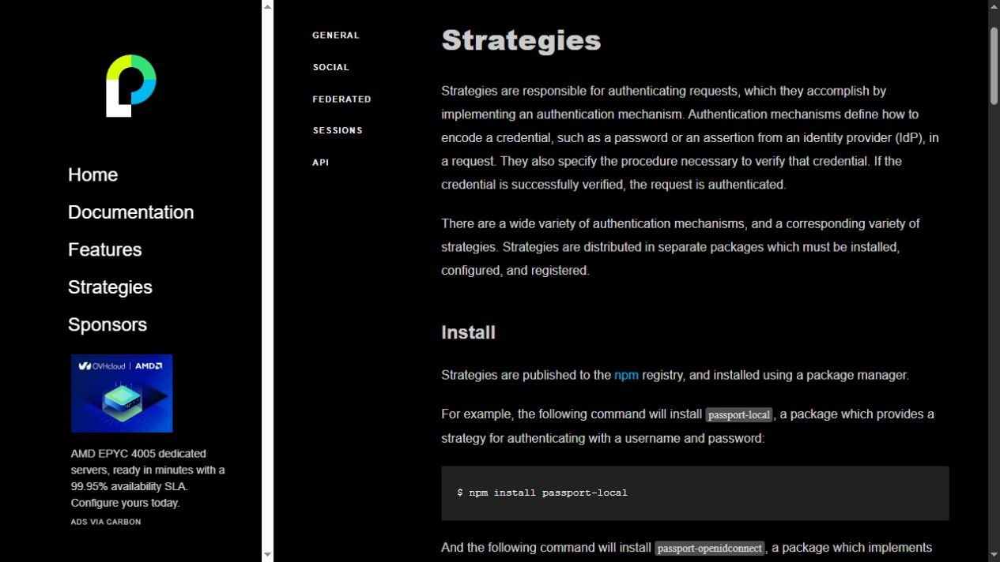
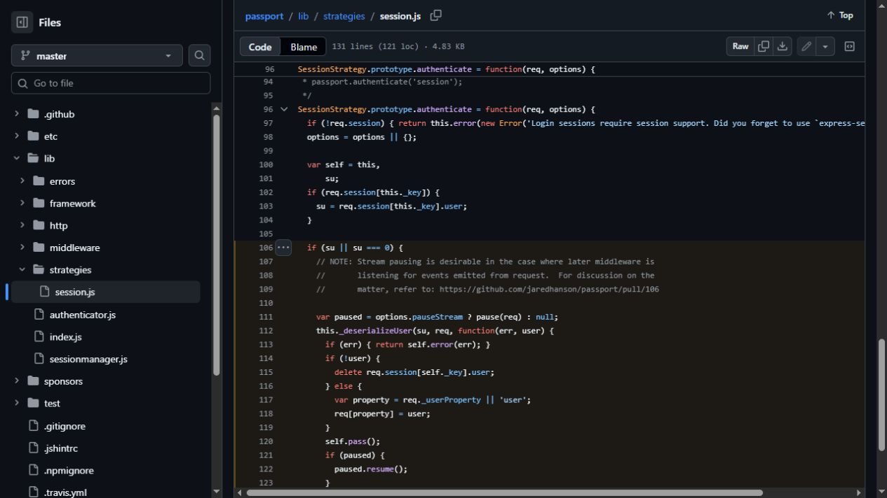

# Passport Knowledge Check

Akam Kahlon

## Question 1

`req.login()` (also called `req.logIn()`) starts the Passport login session. After a strategy succeeds, `passport.authenticate()` normally calls this automatically. Passport then calls our `serializeUser()` function to choose what gets saved. In this project, it saves the user's ID.

Saving only the ID keeps the session small and avoids copying the password and other account details into it. On later requests, `deserializeUser()` uses that ID to look up the current user. Changes to the user's name or role are therefore available on the next request instead of using an old copy stored at login.

Sources: https://www.passportjs.org/concepts/authentication/login/ and https://www.passportjs.org/concepts/authentication/sessions/

## Question 2A

`passport.use()` registers a strategy so Passport can find it by name. It does not log anyone in by itself. `passport.authenticate()` selects that registered strategy and runs it for an incoming request. For example, registering the local strategy makes it available to `passport.authenticate("local")` on the login route.

Source: https://www.passportjs.org/concepts/authentication/strategies/#register

## Question 2B

When we call `passport.use(strategy)` without a separate name, Passport uses the strategy object's own `name` property. The strategy package supplies this default. For example, `passport-local` uses `local`, so we use `passport.authenticate("local")`. The package documentation identifies the name; the usual package naming convention is `passport-{name}`. Passing a name explicitly to `passport.use(name, strategy)` overrides that default registration name.

The official documentation's Register section explains default names and how they are used by `passport.authenticate()`.

Source: https://www.passportjs.org/concepts/authentication/strategies/#register

## Question 3

`passport.session()` runs the built-in session strategy. Our app installs it after `express-session` and before the routes, so requests reaching those routes pass through it.

In Passport's `lib/strategies/session.js`, lines 102–103 read the saved user value from the session. In this project, that value is the user's ID. Line 112 calls `this._deserializeUser(su, ...)`, which runs our deserialization callback. Our callback calls `getUserById(id)` to retrieve the current user from the array.

Lines 117–118 choose the user property (normally `user`) and assign the returned user to `req[property]`. This is how `req.user` gets populated before the route handler runs. If the user no longer exists, lines 114–115 remove the session's stored user value instead.

The freshness comes from our callback looking up the current user each time. Passport does not automatically query our database. Requests without an authenticated session do not deserialize a logged-in user, and static files served before the Passport middleware do not reach it.

Source: https://github.com/jaredhanson/passport/blob/master/lib/strategies/session.js#L102-L125
